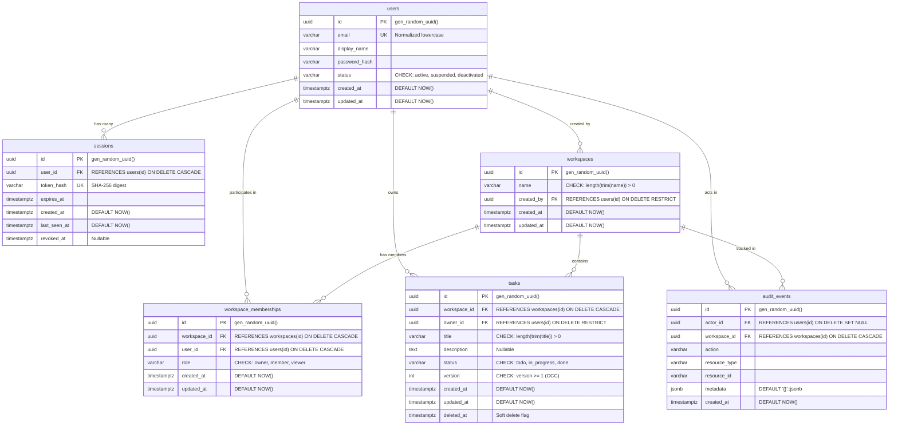

# Database Schema & Integrity Constraints

## 1. Relational Schema Diagram

---

## 2. Table Specifications

### 2.1 `users`
Represents an authenticated user identity.

| Column | Type | Constraints | Description |
|---|---|---|---|
| `id` | `UUID` | `PRIMARY KEY DEFAULT gen_random_uuid()` | Immutable internal identifier. |
| `email` | `VARCHAR(255)` | `NOT NULL` | User email address. |
| `display_name` | `VARCHAR(100)` | `NOT NULL` | Human-readable user name. |
| `password_hash` | `VARCHAR(255)` | `NOT NULL` | Argon2id password hash. Never returned by public queries. |
| `status` | `VARCHAR(20)` | `NOT NULL DEFAULT 'active' CHECK (status IN ('active', 'suspended', 'deactivated'))` | Account status. |
| `created_at` | `TIMESTAMPTZ` | `NOT NULL DEFAULT NOW()` | Account creation time (UTC). |
| `updated_at` | `TIMESTAMPTZ` | `NOT NULL DEFAULT NOW()` | Last update time (UTC). |

**Indexes:**
- `idx_users_email_lower` (`UNIQUE INDEX ON users (LOWER(email))`): Enforces case-insensitive email uniqueness.

---

### 2.2 `sessions`
Represents a durable server-managed session.

| Column | Type | Constraints | Description |
|---|---|---|---|
| `id` | `UUID` | `PRIMARY KEY DEFAULT gen_random_uuid()` | Internal session identifier. |
| `user_id` | `UUID` | `NOT NULL REFERENCES users(id) ON DELETE CASCADE` | Associated user. |
| `token_hash` | `VARCHAR(64)` | `NOT NULL UNIQUE` | SHA-256 hexadecimal digest of the bearer token. |
| `expires_at` | `TIMESTAMPTZ` | `NOT NULL` | Expiration time. |
| `created_at` | `TIMESTAMPTZ` | `NOT NULL DEFAULT NOW()` | Session establishment time. |
| `last_seen_at` | `TIMESTAMPTZ` | `NOT NULL DEFAULT NOW()` | Updated on every authenticated request. |
| `revoked_at` | `TIMESTAMPTZ` | `NULLABLE` | Timestamp of explicit revocation (logout). |

**Indexes:**
- `idx_sessions_token_hash` on `token_hash`: Fast $O(1)$ token lookup.
- `idx_sessions_user_id` on `user_id`: Fast session invalidation per user.
- `idx_sessions_expires_at` on `expires_at`: Efficient cron/background cleanup.

---

### 2.3 `workspaces`
Represents an isolated organizational tenant or team boundary.

| Column | Type | Constraints | Description |
|---|---|---|---|
| `id` | `UUID` | `PRIMARY KEY DEFAULT gen_random_uuid()` | Workspace identifier. |
| `name` | `VARCHAR(100)` | `NOT NULL CHECK (length(trim(name)) > 0)` | Workspace name (cannot be whitespace). |
| `created_by` | `UUID` | `NOT NULL REFERENCES users(id) ON DELETE RESTRICT` | Creator identity. |
| `created_at` | `TIMESTAMPTZ` | `NOT NULL DEFAULT NOW()` | Creation timestamp. |
| `updated_at` | `TIMESTAMPTZ` | `NOT NULL DEFAULT NOW()` | Last modification timestamp. |

---

### 2.4 `workspace_memberships`
Defines user membership and RBAC role within a workspace.

| Column | Type | Constraints | Description |
|---|---|---|---|
| `id` | `UUID` | `PRIMARY KEY DEFAULT gen_random_uuid()` | Membership record ID. |
| `workspace_id` | `UUID` | `NOT NULL REFERENCES workspaces(id) ON DELETE CASCADE` | Target workspace. |
| `user_id` | `UUID` | `NOT NULL REFERENCES users(id) ON DELETE CASCADE` | Member user. |
| `role` | `VARCHAR(20)` | `NOT NULL CHECK (role IN ('owner', 'member', 'viewer'))` | RBAC role. |
| `created_at` | `TIMESTAMPTZ` | `NOT NULL DEFAULT NOW()` | Timestamp joined. |
| `updated_at` | `TIMESTAMPTZ` | `NOT NULL DEFAULT NOW()` | Role modification timestamp. |

**Constraints:**
- `CONSTRAINT uq_workspace_member UNIQUE (workspace_id, user_id)`: Prevents duplicate memberships for the same user in a workspace.

---

### 2.5 `tasks`
Represents an actionable domain entity governed by RBAC, optimistic locking, and soft deletion.

| Column | Type | Constraints | Description |
|---|---|---|---|
| `id` | `UUID` | `PRIMARY KEY DEFAULT gen_random_uuid()` | Task identifier. |
| `workspace_id` | `UUID` | `NOT NULL REFERENCES workspaces(id) ON DELETE CASCADE` | Parent workspace. |
| `owner_id` | `UUID` | `NOT NULL REFERENCES users(id) ON DELETE RESTRICT` | User who created the task. |
| `title` | `VARCHAR(200)` | `NOT NULL CHECK (length(trim(title)) > 0)` | Task title. |
| `description` | `TEXT` | `NULLABLE` | Optional detailed content. |
| `status` | `VARCHAR(20)` | `NOT NULL DEFAULT 'todo' CHECK (status IN ('todo', 'in_progress', 'done'))` | Task status. |
| `version` | `INTEGER` | `NOT NULL DEFAULT 1 CHECK (version >= 1)` | Optimistic Concurrency Control counter. |
| `created_at` | `TIMESTAMPTZ` | `NOT NULL DEFAULT NOW()` | Creation timestamp. |
| `updated_at` | `TIMESTAMPTZ` | `NOT NULL DEFAULT NOW()` | Modification timestamp. |
| `deleted_at` | `TIMESTAMPTZ` | `NULLABLE` | Soft-deletion timestamp. |

**Indexes:**
- `idx_tasks_workspace_status` on `(workspace_id, status) WHERE deleted_at IS NULL`: Partial index for rapid workspace task filtering.
- `idx_tasks_owner_id` on `owner_id`: Index on owner queries.
- `idx_tasks_deleted_at` on `deleted_at`: Soft-deletion filtering.

---

### 2.6 `audit_events`
Immutable record of security-critical actions and resource mutations.

| Column | Type | Constraints | Description |
|---|---|---|---|
| `id` | `UUID` | `PRIMARY KEY DEFAULT gen_random_uuid()` | Event identifier. |
| `actor_id` | `UUID` | `NULLABLE REFERENCES users(id) ON DELETE SET NULL` | Performing user identity. |
| `workspace_id` | `UUID` | `NULLABLE REFERENCES workspaces(id) ON DELETE CASCADE` | Associated workspace. |
| `action` | `VARCHAR(100)` | `NOT NULL` | Action code (e.g. `task.created`, `member.added`). |
| `resource_type`| `VARCHAR(50)` | `NOT NULL` | Resource category (`task`, `workspace`, `session`). |
| `resource_id` | `VARCHAR(100)` | `NOT NULL` | Primary identifier of affected entity. |
| `metadata` | `JSONB` | `NOT NULL DEFAULT '{}'::jsonb` | Structured details of changes. |
| `created_at` | `TIMESTAMPTZ` | `NOT NULL DEFAULT NOW()` | Event occurrence timestamp. |

**Indexes:**
- `idx_audit_events_workspace` on `(workspace_id, created_at DESC)`: Rapid audit history retrieval.

